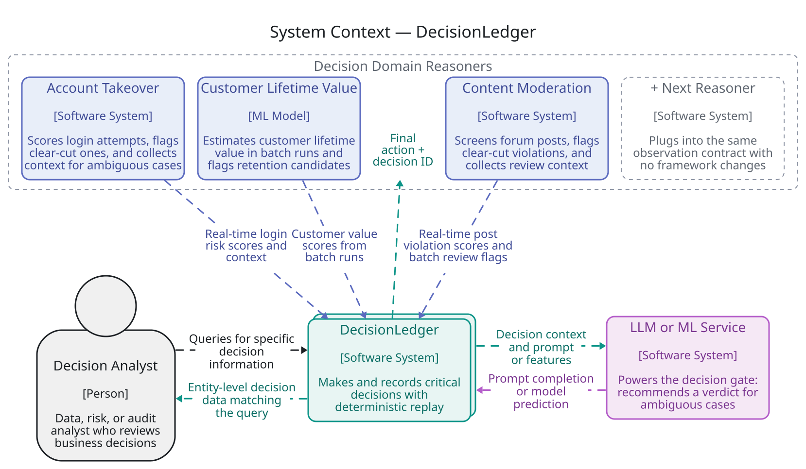
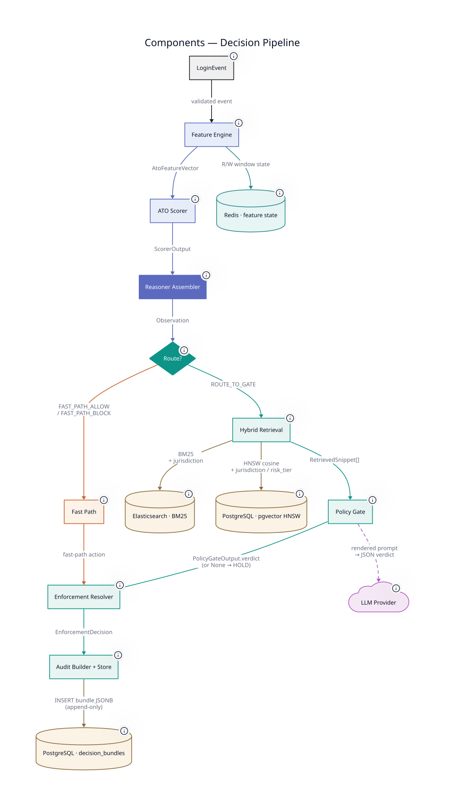

# Architecture

DecisionLedger uses C4-model-based architecture. 

## System Diagram - Level 1



Every reasoner submits an *observation* (its scores plus the context behind them) through the same contract, and DecisionLedger returns the final action to whichever reasoner submitted it. Account Takeover is the shipped reference reasoner; Content Moderation, Customer Lifetime Value, and the dashed "+ Next Reasoner" are illustrative. The LLM or ML service only recommends a verdict; deterministic enforcement inside DecisionLedger makes the call. At runtime that service is OpenAI GPT-4o. Arrow color marks the element that starts each exchange.

## Containers Diagram - Level 2

![C4 containers: the Decision API runs the mounted Account Takeover reasoner in-process (other reasoners shown are illustrative) and, through the mounted Account Takeover code, reads and writes that reasoner's feature state in its own Redis, drawn outside the DecisionLedger boundary; for gate-routed cases it searches policy chunks in PostgreSQL (pgvector) and Elasticsearch and asks the LLM or ML service for a verdict; it records every decision bundle in PostgreSQL, returns the final action and decision ID, and serves bundle lookup and replay to the decision analyst](../assets/diagrams/containers.svg)

DecisionLedger runs as one process, the Decision API (`uv run uvicorn --factory app.main:create_app`), next to three datastores from `docker compose`. PostgreSQL and Elasticsearch are the framework's and shared by every reasoner; Redis belongs to Account Takeover and comes from its own `reasoners/account_takeover/compose.yaml`, which the root compose file pulls in with `include:`. Reasoners are not separate containers: `create_app` discovers each installed reasoner plugin through its entry point and mounts its router and pipeline into the Decision API, and Account Takeover receives login events at `POST /api/v1/ato/decisions` before handing its observation to the framework in-process. Policy retrieval and the LLM call (OpenAI GPT-4o) happen only for cases routed to the gate; every decision writes a bundle to PostgreSQL. The offline tools (corpus loader, eval harness, scorer trainer, scenario generator, and baseline capture) run on demand and are not shown, because the system does not need them running to make decisions. Gate-routed retrieval does depend on one of them: it reads the policy chunks that the corpus loader (`make build-policy-index`) writes to PostgreSQL and Elasticsearch. The eval harness also calls Anthropic Claude for its faithfulness and citation judges. As at Level 1, arrow color marks the element that starts each exchange, and grey arrows come from the illustrative reasoners. Ochre cylinders hold policy data and the decision ledger; the cyan one holds Account Takeover feature state and sits outside the DecisionLedger boundary because the reasoner owns it, so its edge is indigo: Account Takeover code running inside the API process initiates it.

## Component Diagram - Level 3 (Decision Pipeline)



Level 3 zooms into one decision. The indigo half (features, scorer, assembler, and Redis state) is Account Takeover code in `ato_reasoner`; the teal half (routing, retrieval, gate, enforcement, audit) is framework code in `app/`. The assembler's `Observation` is the only thing that crosses from one half to the other.

---

## Directory Layout

The repository is a uv workspace. The root project, `decision-ledger`, is the framework: `core/`, `app/`, and `eval/`. Each reasoner is a workspace member under `reasoners/<name>/` with its own `pyproject.toml` and import package, discovered at runtime through entry points (DR-26).

```
decision-ledger/
├── pyproject.toml            Framework project + workspace root; the `reasoners` dependency group composes the deployment
├── docker-compose.yml        Shared Postgres + Elasticsearch; `include:` pulls in each reasoner's compose.yaml
├── Makefile                  Framework targets; `-include` of every reasoners/*/reasoner.mk
│
├── core/                     Framework contracts — domain-agnostic, no infrastructure dependencies
│   ├── observation/              Observation protocol, ReasonerContext, GateContext, ReasonerRegistration, intake validation
│   ├── gate/                     Universal gate contracts; gate/policy/ holds the LLM policy-gate contracts (prompts, citations, corpus model)
│   ├── resolution/               Append-only resolution attempts (human review, SLA default)
│   ├── llm/                      SDK-agnostic LLMClient protocol (DR-23)
│   ├── eval/                     Eval metric contracts
│   └── bundle.py, actions.py, enforcement.py, routes.py, snippet.py, exceptions.py
│
├── app/                      Framework runtime — imports from core/, adds infrastructure, never imports a reasoner
│   ├── main.py                   create_app() factory: discovers plugins, mounts their routers, serves health/lookup/replay
│   ├── plugin.py                 ReasonerPlugin protocol, FrameworkServices, ReasonerServices
│   ├── plugins.py                Entry-point discovery, DECISIONLEDGER_REASONERS allowlist, registry builder
│   ├── bootstrap.py              build_framework_services — the one place infrastructure clients are built
│   ├── decide.py                 execute_decision: framework half of the handoff (validate → retrieval → gate → enforcement → audit)
│   ├── retrieval/                Hybrid retriever, corpus loader, es/policy-chunks.json (index mapping)
│   ├── gate/policy/              LLM policy gate + YAML prompt registry (loads each plugin's prompts directory)
│   ├── enforcement/              Deterministic rule application, final action resolution
│   ├── audit/                    Bundle construction, store + replay, resolution journal, sql/ (canonical DDL)
│   ├── llm/                      LLMClient adapters (OpenAI, Anthropic) — only files allowed to import an LLM SDK
│   ├── monitoring/               Structured logging, latency tracking
│   ├── reasoner_registry.py      StaticReasonerRegistry (built from the discovered plugins)
│   └── settings.py               FrameworkSettings (.env-driven)
│
├── eval/                     Reasoner-agnostic evaluation harness
│   ├── adapter.py                EvalAdapter / EvalDriver protocols, entry-point loader
│   ├── dimensions/               One module per dimension (retrieval, faithfulness, consistency, citation, robustness)
│   ├── clients/                  RAGAS adapter
│   ├── judge.py                  LLM-as-judge primitive
│   ├── runners/                  harness.py — `--reasoner-id` selects the reasoner's adapter
│   └── prompts/                  Judge prompt templates
│
├── reasoners/                Reasoner plugins — one uv workspace member per domain
│   └── account_takeover/         The reference reasoner (distribution ato-reasoner, import package ato_reasoner)
│       ├── pyproject.toml            Dependencies (xgboost, redis, ...) + the two entry points
│       ├── ruff.toml                 Extends the root Ruff config
│       ├── reasoner.mk               Suffixed Make targets (train-account_takeover, prepare-account_takeover, ...)
│       ├── compose.yaml              Redis (feature windows, dedup, login-event stream)
│       ├── src/ato_reasoner/
│       │   ├── plugin.py                 PLUGIN — the runtime entry-point target
│       │   ├── events.py, features.py    LoginEvent, AtoFeatureVector
│       │   ├── feature_service.py        Online feature computation over Redis
│       │   ├── ingestion/                Redis Streams consumer + dedup
│       │   ├── scorer/                   XGBoost scorer, trainer, model card; models/ holds the artifact
│       │   ├── assembler.py              build_observation() — the framework handoff
│       │   ├── pipeline.py               run_ato_decision (calls app/decide.py:execute_decision)
│       │   ├── api.py                    FastAPI router (POST /api/v1/ato/decisions)
│       │   ├── registry.py               ATO_REGISTRATION (identity, allowed resources, enforcement profile)
│       │   ├── settings.py               AtoSettings (ATO_ prefix)
│       │   ├── retrieval_query.py, policy.py
│       │   ├── prompts/                  ato-v1/v2/v3.yaml
│       │   ├── corpus/                   Policy documents (Markdown + YAML frontmatter)
│       │   ├── generator/                Synthetic scenario generator
│       │   └── eval/                     adapter.py (ADAPTER), driver.py, capture_baselines.py, datasets/
│       └── tests/                    Member tests (collected by the root pytest run)
│
├── tests/                    Framework tests; _stub_reasoner/ is a test-only second reasoner
│
└── docs/                     Design documentation
    ├── design/                   Architecture, pipeline, data, interface, evaluation, infrastructure
    └── assets/diagrams/          Rendered SVGs (committed; regenerate with `just diagrams`)
```

### The `core/`, `app/`, and `reasoners/` Boundaries

`core/` is intentionally free of infrastructure dependencies — no Redis clients, no database drivers, no LLM SDK imports, no FastAPI. It contains the framework's Pydantic contracts, protocols, action space definitions, bundle structure, and evaluation metric interfaces. `core/` imports from nothing internal.

`app/` is the framework runtime. It owns the shared infrastructure (PostgreSQL, Elasticsearch, the LLM providers) and everything after the handoff: retrieval, the policy gate, enforcement, and the audit store. It imports from `core/` and never from a reasoner, `app/main.py` included: reasoners arrive as plugin objects through the `decisionledger.reasoners` entry-point group.

`reasoners/<name>/` holds one domain each. A reasoner owns everything up to and including `build_observation()`: its event types, features, model, ingestion, pipeline, router, settings, prompts, policy corpus, eval adapter and datasets, and any infrastructure only it uses (ATO's Redis). It imports from `core/` and `app/`; neither imports from it.

These boundaries enforce: (1) testability — `core/` is unit-testable without Docker running, and framework tests run against a stub reasoner rather than ATO; (2) modularity — adding a second reasoner domain is a new workspace member with zero changes to `core/`, `app/`, or `eval/`; (3) legibility — a reader can understand the complete decision model by reading `core/` without encountering any ATO-specific types.

---

## Component Overview

Twelve components across the pipeline, organized by phase. `ato_reasoner/` paths are relative to `reasoners/account_takeover/src/`.

| ID | Component | Layer | Phase |
|----|-----------|-------|-------|
| C1 | Scenario Generator | `ato_reasoner/generator/` | Foundation |
| C2 | Policy Corpus | `ato_reasoner/corpus/`, `app/retrieval/corpus_loader.py` | Foundation |
| C2b | Reasoner Assembler | `ato_reasoner/assembler.py` | Foundation |
| C3 | Idempotent Ingestion | `ato_reasoner/ingestion/` | Foundation |
| C4 | Online Feature Computation | `ato_reasoner/feature_service.py` | Core |
| C5 | Fast ML Scorer | `ato_reasoner/scorer/` | Core |
| C6 | Policy RAG Retriever | `app/retrieval/` | Foundation → Core |
| C7 | LLM Policy Gate | `app/gate/policy/` | Core |
| C8 | Deterministic Enforcement | `app/enforcement/` | Core |
| C9 | Decision Bundle + Replay | `app/audit/` | Core |
| C10 | Evaluation Harness | `eval/` (+ `ato_reasoner/eval/` adapter, driver, datasets) | Eval |
| C11 | CI Gate | `.github/workflows/` | Eval |
| C12 | Monitoring | `app/monitoring/` | Eval |

---

## C4 Container Diagram

See [Containers Diagram - Level 2](#containers-diagram-level-2) above.

D2 source: [`docs/design/diagrams/containers.d2`](diagrams/containers.d2)

---

## Dependency Rules

The dependency graph is strictly layered:

```
reasoners/<member> ──→ core/, app/        (its pyproject depends on decision-ledger)
reasoners/<member> ──→ its own infrastructure (ATO: Redis, XGBoost)
eval/              ──→ core/, app/
app/               ──→ core/
app/               ──→ shared infrastructure (PostgreSQL, Elasticsearch, LLM providers)
core/              ──→ [nothing internal]

app/, eval/        ··→ reasoners          entry points only, never an import:
                                          decisionledger.reasoners      (app/plugins.py)
                                          decisionledger.eval_adapters  (eval/adapter.py)
```

The root project never depends on a member: its `[project] dependencies` and wheel name no reasoner. Which reasoners a checkout installs is a deployment choice, recorded in the root `reasoners` dependency group, which `uv sync` installs by default.

`tests/test_framework_boundary.py` makes the rules hard build failures. It fails when anything under `app/`, `core/`, or `eval/` imports a reasoner package or names an ATO symbol, id, template, feature, or jurisdiction (in `.py`, `.yaml`, `.sql`, or the ES mapping); when `core/` imports `app/`; when the root `pyproject.toml` lists a reasoner dependency or entry point; and when a member under `reasoners/` does not declare its own entry points. `core/` additionally may not import an infrastructure SDK; for LLM SDKs the CI `boundary` job enforces that anywhere outside `app/llm/`. The test for `core/`: can this code be unit-tested without Docker running? If no, it does not belong there.

---

## Naming Conventions

| Context | Form | Example |
|---------|------|---------|
| Repo slug | kebab-case | `decision-ledger` |
| Python package / imports | snake_case | `decision_ledger` |
| Class / type references | PascalCase | `DecisionBundle`, `PolicyGateOutput` |
| Prose / documentation | two words | "Decision Ledger" |
| CLI tool | kebab-case | `decision-ledger replay` |
| Pydantic models | PascalCase | `LoginEvent`, `FeatureVector` |
| Enums | UPPER_SNAKE_CASE | `DecisionAction.HOLD` |
| Feature names | snake_case strings | `"velocity_1min"`, `"geo_novelty_score"` |
