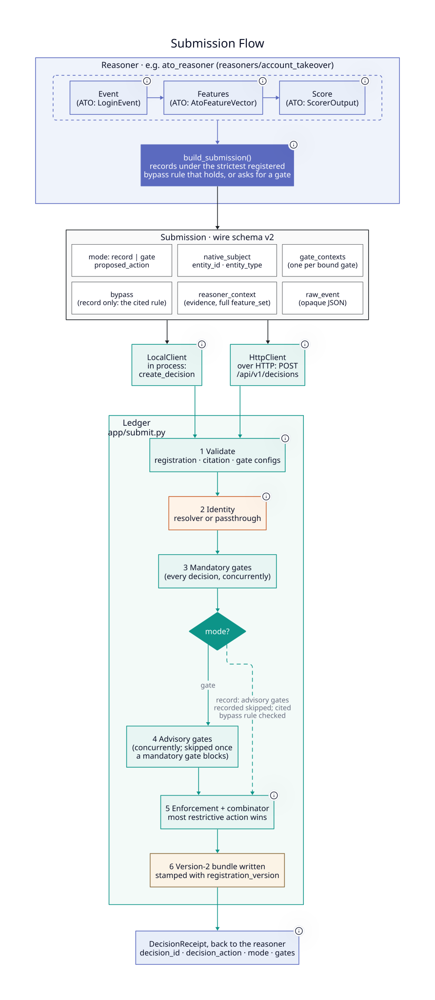

# Reasoner Handoff Contract

The handoff between a domain reasoner and the DecisionLedger framework is the
most important integration boundary in the system. This document defines the
contract — what the domain must provide, what the framework consumes, where
responsibility lies, and how the ATO Reasoner satisfies it as the reference
implementation.

---

## What the Handoff Is

A **domain reasoner** is the ML system that owns observation, feature
computation, and risk scoring for a specific decision domain. In the reference
implementation, the ATO Reasoner is responsible for: ingesting login events,
computing sliding-window behavioural features, and scoring risk with an
XGBoost model.

Physically, a reasoner is a uv workspace member under `reasoners/<name>/` with
its own `pyproject.toml` and import package (ATO: `reasoners/account_takeover/`,
import package `ato_reasoner`). The framework discovers it through Python entry
points and never imports it (DR-26).

The **DecisionLedger framework** takes over from there: policy retrieval, LLM
policy gate reasoning, deterministic enforcement, and Decision Bundle
construction. The framework is domain-agnostic — it has no knowledge of login
events, account IDs, or XGBoost scores unless the domain explicitly provides
that context through the handoff contract.

The handoff happens at a single point: when the domain assembler calls
`build_observation()` and submits the result to the framework pipeline.
Everything before that call is the domain's responsibility. Everything after
is the framework's.



---

## Operating Modes

### Governed Mode (reference implementation)

The domain participates in policy gate oversight. The framework runs full ML +
LLM policy reasoning on every observation. The domain must provide both
`ReasonerContext` and `GateContext` on every observation — including fast-path
ones (see Shadow Evaluation below).

Two routing paths exist within governed mode:

- **Route to Gate** — the domain's confidence band is ambiguous. The framework
  invokes the policy gate, which retrieves relevant policy snippets and calls
  the LLM to produce a structured decision.
- **Fast Path** — the domain's score is in a high-confidence band
  (`FAST_PATH_ALLOW` or `FAST_PATH_BLOCK`). The framework bypasses live gate
  invocation and enforces the fast-path action directly. A
  `fast_path_rationale` is required; `GateContext` is still required (for
  shadow evaluation).

### Audit-Only Mode (future — not implemented in MVP)

The domain opts out of the policy gate entirely. `GateContext` is not required.
DecisionLedger functions as a centralised audit ledger — recording the domain's
decisions for cross-system comparability and compliance reporting. Shadow
evaluation, backtesting, and Reasoner vs Gate comparisons are unavailable.

Opt-out is a registration-time governance decision, not a per-observation flag.
It requires documented justification (e.g., the domain embeds policy rules
upstream, or operates in a risk area with no applicable policy corpus).

---

## The Handoff Contract

### `Observation` Protocol (`core/observation/observation.py`)

The framework accepts any type satisfying this protocol (structural subtyping,
PEP 544). The ATO Reasoner satisfies it via `LoginEvent`.

| Field | Type | Required | Notes |
|---|---|---|---|
| `event_id` | `str` | Always | Unique event identifier |
| `entity_id` | `UUID` | Always | Framework UUID — derived from domain business key via UUID5 |
| `entity_type` | `str` | Always | Subject classification (e.g., `"account"`) |
| `timestamp` | `datetime` | Always | When the event occurred (UTC) |
| `route` | `GateRoute` | Always | `ROUTE_TO_GATE`, `FAST_PATH_ALLOW`, or `FAST_PATH_BLOCK` |
| `reasoner_context` | `ReasonerContext \| None` | Governed mode | `None` only in intermediate pipeline stages pre-assembly |
| `fast_path_rationale` | `str \| None` | Fast path only | Required when routing is fast path — human-readable explanation of why the policy gate was bypassed. `None` when routing to gate. `ObservationContractError` raised if absent on fast-path submission. |
| `gate_context` | `GateContext` | Governed mode | Required on all observations — including fast path |

---

### `ReasonerContext` (`core/observation/reasoner_context.py`)

The domain-agnostic record of what the ML model computed. The framework stores
this verbatim in the Decision Bundle. It is the evidence that makes any
decision auditable and replayable without calling back to the source reasoner.

```
ReasonerContext
├── reasoner_id: str              "ato-reasoner"
├── reasoner_name: str            "ATO Reasoner"
├── model_version: str            "xgb-v1.2.0"
├── inference_latency_ms: float   2.5
│
├── label_type: LabelType         NUMERICAL | CATEGORICAL
├── label_name: str               "risk_score"
├── label_value: float | str      0.87
│
├── feature_set: dict             {velocity_1min: 12, device_novelty: 1.0, ...}
│   All named feature values the model consumed at inference time.
│   This is what makes replay self-contained.
│
└── attribution: AttributionSummary | None
    ├── feature_contributions: list[Contribution] | None   per-event SHAP (or other) values
    ├── feature_importance: dict[str, float] | None   global model weights
    └── narrative: str | None                      free-form explanation
```

**Label types:**

| `label_type` | `label_value` | Example |
|---|---|---|
| `NUMERICAL` | `float` | Risk probability: `0.87` |
| `CATEGORICAL` | `str` | Class label: `"FRAUD"` |

**Attribution:** At least one field in `AttributionSummary` should be populated
for meaningful audit quality. Observation-level SHAP values are the highest
value form — they explain why this specific decision was made, not just what the
model tends to do in general. Attribution is optional because not all deployed
models expose it (vendor black-box models, rule-based reasoners). Omitting it
does not break the pipeline but reduces explainability in the Decision Bundle.

---

### `GateContext` (`core/observation/gate_context.py`)

The domain-assembled dispatch envelope for the gate. `gate_id` selects the
gate implementation and is checked against the registration's
`allowed_gate_ids`. `gate_config` is a dict the framework transports
without interpreting; the selected gate reads the keys it needs. The
reference policy gate uses these well-known keys:

```
GateContext
├── gate_id: str                    "policy"
│   Gate dispatch key; validated against allowed_gate_ids.
│
└── gate_config: dict | None
    ├── template_id: str            "ato-v3"
    │   Audit key — recorded verbatim in the DecisionBundle.
    │   Used to look up the template from the PromptRegistry.
    │   Validated against allowed_prompt_template_ids.
    │   Immutable once deployed; changes require a new version.
    │
    ├── template_vars: dict[str, str]  {"risk_score": "0.870", "auth_method": "PASSWORD", ...}
    │   Pre-rendered strings substituted into the prompt template.
    │   Domain assembler renders typed values to human-readable strings.
    │   Must satisfy the template's required_vars.
    │
    ├── jurisdictions: list[str]    ["US_FEDERAL", "INTERNAL"]
    │   Corpus retrieval filter — applied to both pgvector HNSW and Elasticsearch.
    │   Validated against allowed_jurisdictions.
    │   Empty list = no jurisdiction filter (all documents are candidates).
    │
    ├── risk_tier: str | None       "HIGH_VALUE"
    │   Corpus retrieval filter — applied to pgvector HNSW only.
    │   None = no tier filter (all tiers are candidates).
    │
    └── target_model: str | None    "gpt-4o-2024-08-06"
        Optional LLM model hint. Framework may honor or override per governance policy.
```

**Retrieval filter behaviour:**

| Filter | pgvector (dense) | Elasticsearch (sparse) |
|---|---|---|
| `reasoner_id` (from `ReasonerContext`; mandatory) | ✓ `WHERE reasoner_id = %s` | ✓ `{"term": {"reasoner_id": ...}}` on a `keyword` field |
| `jurisdictions` | ✓ `WHERE jurisdiction = ANY(%s)` | ✓ `{"terms": {"jurisdiction": [...]}}` |
| `risk_tier` | ✓ `WHERE risk_tier = %s OR risk_tier IS NULL` | ✗ not applied |

**Why `GateContext` is required on fast-path observations:**
See Shadow Evaluation below.

---

### Intake Validation (`core/observation/observation.py`)

`app/decide.py:execute_decision` calls
`validate_observation(observation, registry=registry)` before any routing or
gate invocation, with the deployment's reasoner registry (built from the
discovered plugins' registrations). This is the authoritative enforcement
point for the Observation contract — it applies to every domain reasoner
implementation regardless of the concrete type.

Shape contracts, checked unconditionally:

1. **`reasoner_context` must not be `None`** in governed mode. All framework
   pipeline operations require a populated `ReasonerContext`.
2. **`fast_path_rationale` must be present when `route` is `FAST_PATH_*`.**
   The policy gate was bypassed — the rationale is the mandatory audit trail
   explaining why.

Registration contracts, checked against the registry:

3. **`reasoner_context.reasoner_id` must be registered**, otherwise
   `UnregisteredReasonerError`.
4. **`gate_context.gate_id` must be in `allowed_gate_ids`.**
5. **`gate_config["template_id"]` and `gate_config["jurisdictions"]`**, when
   present, must be in `allowed_prompt_template_ids` and
   `allowed_jurisdictions` (an empty allowed set means no restriction).

Violations raise `ObservationContractError`, which names the responsible
reasoner (from `reasoner_context.reasoner_id`) and describes the specific
clause broken. This makes it unambiguous which domain component failed to
satisfy the contract.

---

## Responsibility Boundary

| Responsibility | Reasoner | Framework |
|---|---|---|
| Raw event schema (`LoginEvent`, `ContentItem`, …) | ✓ Owns | — |
| Ingestion adapter (Redis Streams, Kafka, etc.) | ✓ Owns | — |
| Feature computation infra | ✓ Owns | — |
| ML model artifacts + training | ✓ Owns | — |
| Risk scoring at inference | ✓ Owns | — |
| Retrieval-query rendering | ✓ Owns | Consumes string |
| Routing decision (`GateRoute`) | ✓ Produces | Consumes |
| `ReasonerContext` assembly | ✓ Assembles | Stores verbatim |
| `GateContext` assembly | ✓ Assembles | Consumes |
| `fast_path_rationale` | ✓ Provides (fast path) | Validates + stores |
| `entity_id` derivation (UUID5) | ✓ Owns | Uses |
| Reasoner registration record + enforcement profile | ✓ Owns | Validates against; enforcement reads the profile |
| Plugin object + entry points (`decisionledger.reasoners`, `decisionledger.eval_adapters`) | ✓ Declares | Discovers |
| FastAPI route for the reasoner | ✓ Owns | Mounts the plugin's `router` in `create_app` |
| Raw-event JSON deserializer | ✓ Provides factory | `BundleStore` dispatches by `reasoner_id` |
| Prompt templates (`prompts/*.yaml`, incl. `system:`) | ✓ Owns | Loads from the plugin's `prompts_dir` |
| Policy corpus documents | ✓ Owns | Indexes from the plugin's `corpus_dir` |
| Reasoner-only infrastructure (ATO: Redis) | ✓ Owns (`compose.yaml`, `<PREFIX>_` settings) | — |
| Eval adapter, driver, golden datasets | ✓ Owns | Harness runs the five dimensions |
| Policy corpus retrieval | — | ✓ Owns (filters by `reasoner_id`) |
| Policy gate invocation | — | ✓ Owns (reasoner-agnostic) |
| Deterministic enforcement | — | ✓ Owns |
| Decision Bundle construction | — | ✓ Owns |
| Audit storage (Postgres `decisionledger.*`) | — | ✓ Owns |
| Shared infra config (`postgres_*`, ES, LLM keys, `DECISIONLEDGER_REASONERS`) | — | ✓ Owns |
| Reasoner-specific config (`ATO_REDIS_URL`, `ATO_SCORER_MODEL_PATH`, …) | ✓ Owns (`ATO_*` prefix, read by `AtoSettings`) | — |

The domain pipeline is the only orchestrator that crosses the boundary. It is the
reasoner's responsibility to ensure the assembled `Observation` is correct and
complete before submission. The framework trusts the submitted observation — it
does not re-validate domain-specific logic.

There is no import seam between the framework and a reasoner. Each reasoner
publishes one object satisfying `app/plugin.py:ReasonerPlugin` under the
`decisionledger.reasoners` entry-point group, named after its `reasoner_id`
(ATO: `ato-reasoner = "ato_reasoner.plugin:PLUGIN"`). The plugin carries the
`registration`, the FastAPI `router`, `prompts_dir`, `corpus_dir`, the
`raw_event_factory` replay uses, and `build_services(framework)`.

`app/main.py:create_app` discovers the installed plugins
(`app/plugins.py:discover_plugins`, optionally filtered by
`DECISIONLEDGER_REASONERS`) and mounts their routers. Its lifespan builds the
shared infrastructure once (`app/bootstrap.py:build_framework_services`:
Postgres, Elasticsearch, retriever, prompt registry fed by every plugin's
`prompts_dir`, gate, bundle store fed by every plugin's `raw_event_factory`,
and the registry of every plugin's `registration`), stores it on
`app.state.framework`, then calls each plugin's `build_services(framework)`
and stores the result on `app.state.reasoners[reasoner_id]`. The reasoner's
router reads its own services from there. No module under `app/`, `core/`,
or `eval/` imports from a reasoner package, `app/main.py` included —
`tests/test_framework_boundary.py` enforces this.

---

## Shadow Evaluation

`GateContext` is required on **every** observation, including fast-path ones.
This is not overhead — it is what makes shadow evaluation possible.

Shadow evaluation is the ability to retrospectively route any fast-path
decision through the policy gate offline, using the exact same observation
context that was present at decision time, without re-running the domain
pipeline. This enables:

- **Backtesting** — after deploying a new policy or prompt version, evaluate
  how past fast-path decisions would have been handled under the new regime.
- **Reasoner vs Gate comparison** — for any population of fast-path decisions,
  quantify how often the gate would agree or disagree with the scorer's routing.
- **Calibration evidence** — evidence that the fast-path confidence thresholds
  are correctly set relative to what the gate would have decided.

If `GateContext` is absent on fast-path observations, shadow evaluation is
permanently unavailable for those decisions. The DecisionBundle would be
incomplete.

---

## The Assembler Pattern (ATO Reference Implementation)

The ATO Reasoner implements the handoff via `build_observation()` in
`ato_reasoner/assembler.py`. The function takes the three domain
artifacts and returns a fully-populated `LoginEvent` satisfying `Observation`.

### Translation mapping

```
ScorerOutput → ReasonerContext
  reasoner_id           = "ato-reasoner"
  reasoner_name         = "ATO Reasoner"
  model_version         ← scorer_output.scorer_version
  inference_latency_ms  ← scorer_output.inference_latency_ms
  label_type            = NUMERICAL
  label_name            = "risk_score"
  label_value           ← scorer_output.risk_score
  feature_set           ← AtoFeatureVector fields as a flat dict
  attribution           ← AttributionSummary(feature_contributions=top_signals)

LoginEvent + ScorerOutput → GateContext
  gate_id               = "policy"
  gate_config:
    template_id         = "ato-v3"
    jurisdictions       ← resolved from event geo (US → US_FEDERAL + INTERNAL)
    risk_tier           ← resolved from risk score band (≥ 0.60 → HIGH_VALUE)
    template_vars       ← rendered strings for each {placeholder} in ato-v3.yaml

ScorerOutput → fast_path_rationale  (only when routing ≠ ROUTE_TO_GATE)
  Human-readable description of the confidence-band rule that fired.
  e.g. "risk_score=0.970 > 0.95 → FAST_PATH_BLOCK"
  Set directly on the outbound Observation. None when routing to gate.
```

### Implementing a new reasoner

A new reasoner ships as a new uv workspace member under `reasoners/<domain>/`.
The framework remains untouched: no edits under `core/`, `app/`, or `eval/`,
and no edits to the root `Makefile`. The root `pyproject.toml` changes only in
the deployment-composition lines (the `reasoners` dependency group and its
workspace source) that decide whether this checkout installs the new member.

**File-by-file checklist** — using a hypothetical `content_moderation`
reasoner as a worked example (it does not exist in the repository):

```
reasoners/content_moderation/
├── pyproject.toml              # dist "cm-reasoner"; depends on decision-ledger; two entry points
├── ruff.toml                   # extend = "../../pyproject.toml"; known-first-party += cm_reasoner
├── reasoner.mk                 # train-content_moderation, prepare-content_moderation, eval-content_moderation, ...
├── compose.yaml                # infrastructure only this reasoner uses (optional)
├── README.md
├── src/cm_reasoner/
│   ├── plugin.py               # PLUGIN: ReasonerPlugin (runtime entry-point target)
│   ├── events.py               # ContentItem (the raw event), domain enums
│   ├── features.py             # ContentFeatures Pydantic shell
│   ├── feature_service.py      # Feature computation infra
│   ├── ingestion/              # Adapter for the reasoner's input source (optional)
│   ├── scorer/                 # ML scorer infra + model artifact
│   │   ├── output.py           # ContentScorerOutput Pydantic shell
│   │   ├── scorer.py           # Inference
│   │   ├── trainer.py          # Training entry point
│   │   └── models/cm-v1.ubj    # Trained artifact (or .safetensors etc.)
│   ├── retrieval_query.py      # build_cm_query(event, scorer_output) -> str
│   ├── assembler.py            # build_observation(event, features, scorer)
│   ├── pipeline.py             # run_cm_decision(...) -> DecisionBundle
│   ├── api.py                  # APIRouter(prefix="/api/v1/cm"): POST /decisions
│   ├── settings.py             # CmSettings (env_prefix="CM_")
│   ├── registry.py             # CM_REGISTRATION (identity, allowed resources, enforcement profile)
│   ├── prompts/cm-v1.yaml      # template_id, system:, template
│   ├── corpus/                 # Policy documents (Markdown + YAML frontmatter)
│   └── eval/
│       ├── adapter.py          # ADAPTER: EvalAdapter (eval entry-point target)
│       ├── driver.py           # in-process EvalDriver
│       └── datasets/           # retrieval/, faithfulness/, scenarios/, citations/, robustness/
└── tests/                      # no __init__.py; collected by the root pytest run
```

**Steps:**

1. **Create the package skeleton and `pyproject.toml`.** Src layout, a
   distinct top-level import package (`cm_reasoner`), a dependency on
   `decision-ledger` with `[tool.uv.sources] decision-ledger = { workspace =
   true }`, your own ML and infrastructure dependencies, and two entry points
   whose name equals your `reasoner_id`:
   ```toml
   [project.entry-points."decisionledger.reasoners"]
   cm-reasoner = "cm_reasoner.plugin:PLUGIN"

   [project.entry-points."decisionledger.eval_adapters"]
   cm-reasoner = "cm_reasoner.eval.adapter:ADAPTER"
   ```

2. **Define your domain types and model infra** in `events.py`,
   `features.py`, `feature_service.py`, and `scorer/`. Use whatever ML
   framework or feature store fits — this is where reasoner-specific infra
   lives. Derive `entity_id` deterministically from your business key via
   UUID5 with a fresh namespace UUID (mirror the ATO pattern).

3. **Write your assembler** (`assembler.py`). `build_observation(event,
   features, scorer)` returns a type satisfying the `Observation` protocol
   with `reasoner_context.reasoner_id = "cm-reasoner"`, a populated
   `gate_context` (`gate_id="policy"`, `gate_config` with `template_id`,
   `template_vars`, `jurisdictions`, `risk_tier`), and a fast-path rationale
   when applicable.

4. **Render your retrieval query** (`retrieval_query.py`). Map the top scorer
   signals + raw-event metadata to a natural-language string. The framework
   retriever consumes this string — it never sees your event schema.

5. **Write your pipeline** (`pipeline.py`). `run_cm_decision(*, event,
   services, framework, ...)` computes features, scores, calls
   `build_observation`, then delegates to
   `app.decide.execute_decision(observation=..., query=...,
   retriever=framework.retriever, gate=framework.gate,
   store=framework.store, registry=framework.registry, ...)`.

6. **Write your FastAPI router** (`api.py`). Define an `APIRouter(prefix=
   "/api/v1/cm")` and register `POST /decisions`. Read your services from
   `request.app.state.reasoners["cm-reasoner"]` and the shared ones from
   `request.app.state.framework`. Do not edit `app/main.py`; `create_app`
   mounts the router from your plugin.

7. **Add your settings class** (`settings.py`). `CmSettings` with
   `env_prefix="CM_"` for everything reasoner-specific (model paths, corpus
   version, connection URLs for infrastructure only you use). Shared infra
   (Postgres, Elasticsearch, LLM keys) stays in `FrameworkSettings` and
   reaches you through `FrameworkServices`.

8. **Ship your prompt templates** in `prompts/<template-id>.yaml`. Define the
   `{placeholder}` variables your assembler populates in `template_vars`, and
   put your domain's LLM framing in a top-level `system:` key (without one,
   the gate uses the framework's generic `DEFAULT_SYSTEM_TEXT`). Template ids
   are global across the deployment: reusing another reasoner's id fails
   startup.

9. **Add your registration constant** (`registry.py`).
   `CM_REGISTRATION = ReasonerRegistration(reasoner_id="cm-reasoner", ...)`
   with your allowed gate ids, template ids, and jurisdictions, plus the
   enforcement profile: `novel_entity_feature` (the `feature_set` key that
   marks a subject with too little history, or `None`) and
   `jurisdiction_conflict_groups` (groups of jurisdiction tags whose
   policies conflict with each other, or `()`).

10. **Publish the plugin and the eval adapter.** `plugin.py` exposes `PLUGIN`
    with `registration`, `router`, `prompts_dir`, `corpus_dir`,
    `raw_event_factory` (rebuilds your event from the stored `raw_event`
    JSON for replay), and `build_services(framework)` (opens your own
    connections, loads your model, returns an object with `close()`).
    `eval/adapter.py` exposes `ADAPTER` with `reasoner_id`, `event_type`,
    `datasets_dir`, and `build_driver(settings)`.

11. **Add your policy corpus** under `corpus/`, then index it. The loader
    resolves `corpus_dir` from your plugin by id:
    ```bash
    uv run python -m app.retrieval.corpus_loader --reasoner-id cm-reasoner --wipe
    ```

12. **Add `reasoner.mk` and, if needed, `compose.yaml`.** `reasoner.mk`
    defines targets suffixed with your directory name and appends them to
    the root aggregates (`REASONER_TRAIN_TARGETS`, `REASONER_INDEX_TARGETS`,
    `REASONER_PREPARE_TARGETS`, `REASONER_EVAL_TARGETS`); the root
    `Makefile` picks it up with `-include $(wildcard reasoners/*/reasoner.mk)`.
    `compose.yaml` holds infrastructure only you use; add it to the
    `include:` list in the root `docker-compose.yml`, the one deployment
    file that names reasoners.

13. **Install it.** Add `"cm-reasoner"` to the root `reasoners` dependency
    group with a `{ workspace = true }` source, then run `uv sync`. Entry
    points are written at install time, so re-run `uv sync` after any
    change to your `pyproject.toml`. Confirm discovery with
    `uv run python -c "from app.plugins import discover_plugins; print([p.registration.reasoner_id for p in discover_plugins()])"`.

The framework's audit ledger, retrieval index, and policy gate are shared
across reasoners. CM decisions land in the same `decisionledger.decision_bundles`
table as ATO decisions, distinguished by `reasoner_id = "cm-reasoner"`. The
retrieval corpus and policy chunks share the index, filtered by `reasoner_id`
at query time. No schema changes are required.

### Zero framework diff

A new reasoner is correct when it needs no edit under `core/`, `app/`, or
`eval/`. `tests/test_framework_boundary.py` checks the parts of that a
machine can check:

- No `.py` file under `app/`, `core/`, or `eval/` imports `reasoner`,
  `reasoners`, or `ato_reasoner` (there is no `app/main.py` exception).
- No `.py`, `.yaml`, or `.sql` under those trees, nor the packaged ES
  mapping, contains an ATO token (`LoginEvent`, `ato-reasoner`, `ato-v3`,
  `sparse_history`, `US_FEDERAL`, the word "ATO", and so on). Nothing is
  allowlisted; a leak is fixed by rewording.
- `core/` does not import `app/`.
- The root `pyproject.toml` lists no reasoner dependency (nor xgboost,
  pandas, redis, sqlalchemy, alembic) in `[project] dependencies`, declares
  no entry points of its own, and builds a wheel of only `core`, `app`,
  `eval`.
- Every member under `reasoners/*` declares its own runtime and eval entry
  points, pointing into its own import package.

The executable proof is `tests/_stub_reasoner/`: a second, minimal reasoner
(`stub-reasoner`, with its own event type, registration and enforcement
profile, router at `/api/v1/stub`, `stub-v1` prompt, and two-document corpus)
that the framework test suite composes with `create_app(plugins=[...])`,
discovers through an in-test entry point, indexes with the corpus loader,
and replays through the bundle store, without any framework module knowing
it exists. When adding a reasoner, also extend the integration and eval CI
matrices (`matrix.reasoner`) with your directory name.

---

## Replay Guarantee

A Decision Bundle is considered complete and replayable if and only if:

1. `raw_event.reasoner_context.feature_set` contains the full feature snapshot
   at inference time (enables feature drift detection on replay).
2. `raw_event.reasoner_context.model_version` identifies the model artifact
   used (enables version-specific replay analysis).
3. On fast path: `raw_event.fast_path_rationale` records the confidence-band
   rule that fired (enables threshold verification without re-running inference).
4. On gate path: `gate_input` and `gate_output` are stored (typed
   contracts per DR-19). Replay re-runs enforcement against
   `gate_output.verdict` — the gate is not re-invoked, regardless of its
   implementation.
5. `raw_event.gate_context.gate_config` carries `template_id` and `template_vars`
   (enables reconstruction of the exact prompt that was rendered, and shadow
   evaluation of any fast-path decision).

The enforcement layer is deterministic: re-executing `enforcement.resolve()`
against the logged `gate_output.verdict` must produce the same `decision_action`.
This is the replay guarantee. It holds because the LLM output is cached — not
because the LLM itself is deterministic.
